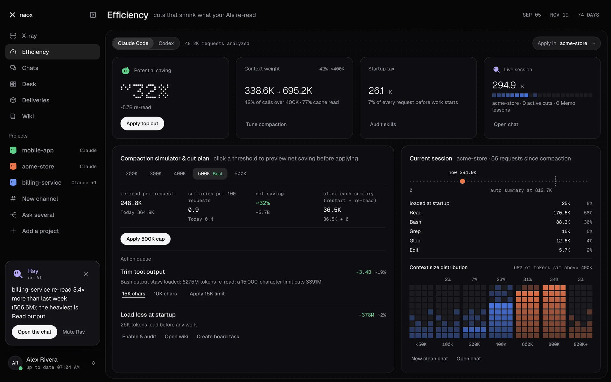
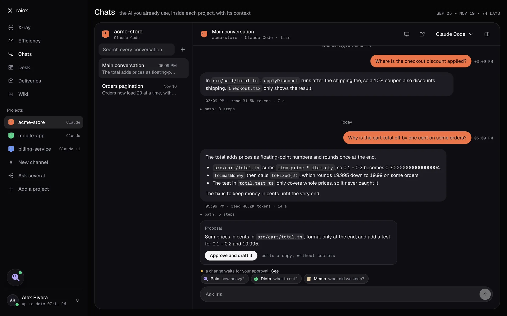
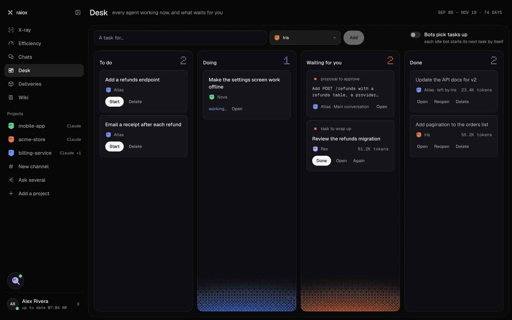
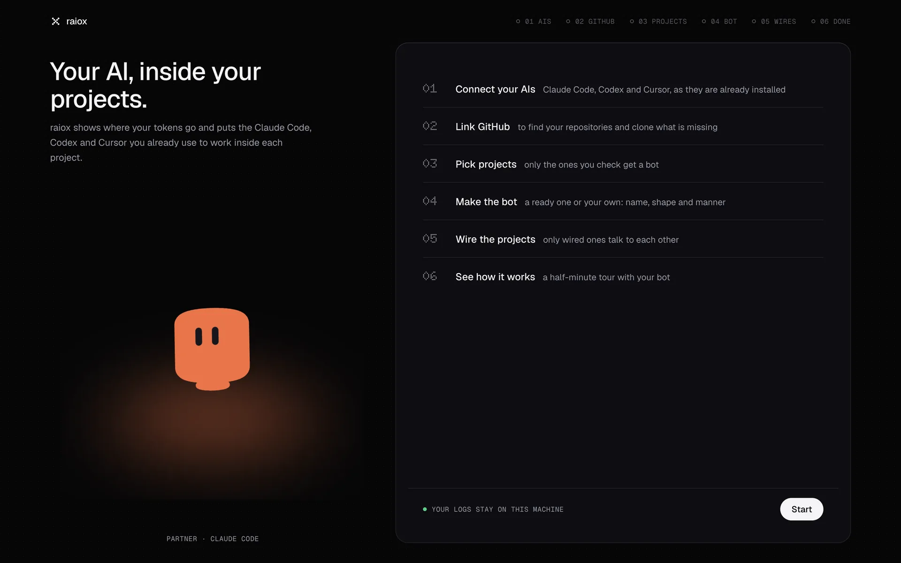
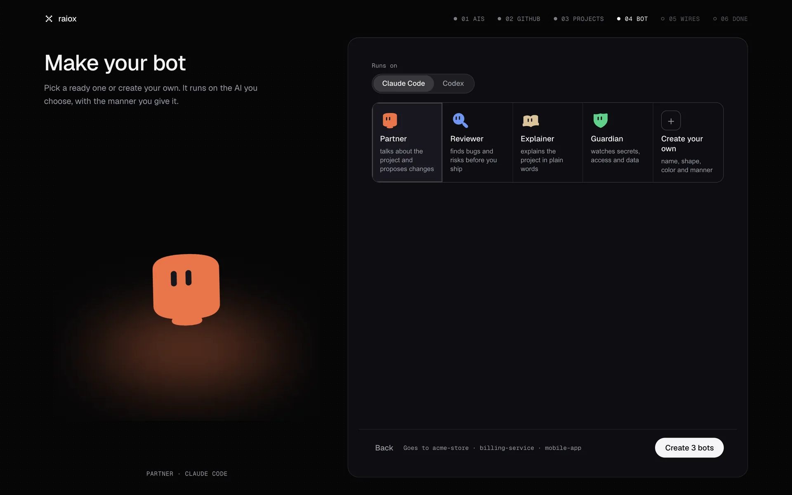

# raiox

An x-ray of your AI coding agents, and a team made of them. raiox works with
the CLIs you already use: **Claude Code, Codex, Cursor, Google's Antigravity
CLI and opencode** (which reaches any provider, free models included).

- **See where the tokens go**: what your Claude Code and Codex sessions read
  and re-read, per project, and what to cut.
- **Put them to work**: each of your projects gets a bot on the CLI you pick,
  with its context. Chat with it, give it tasks, let bots talk in channels.
  Changes wait for your approval, unless you let a bot you trust edit on its
  own (always undoable).

Everything runs locally. raiox reads the logs your CLIs already write, serves a
panel on `127.0.0.1`, and never sends your data anywhere.


<sub>Screenshots show a demo with made-up projects and usage.</sub>

## What it does

**X-ray.** Tokens your AIs read and wrote, what that would cost paying per use,
how much each request re-reads, what gets re-read most (tool output, your own
prompts, system text), tokens per project, and how often a secrets file such as
`.env` entered a conversation (counts only; the text is never kept).

**Efficiency.** Ranked cuts with the estimated saving, measured from your own
logs: compacting earlier, loading less at startup, keeping screenshots out of
the main session. In a project's chat, Dieta computes them from that
project's own requests once it has enough. The ones that are a setting apply
to the project you pick,
with a backup and an undo, and raiox measures the result afterwards.



**Chats.** Turn on a project and talk to the CLI you already use there (Claude
Code, Codex, Cursor, Google's Antigravity CLI `agy`, or opencode, which reaches
any provider and has free models), with the project's context:

- it only reads while talking. When you approve a proposal, it edits a copy
  of the project (following your `.gitignore`, without secrets files) and you
  see what changed in each file, then apply it to the project (with undo) or
  discard it;
- with two AIs in a project, one can review the other's proposal before you
  approve it (on a click, or every time), and the edit is told what the
  review said;
- when an answer needs a command's output (the git history, the tests), the AI
  asks for it and raiox runs that exact command in the project folder, without
  a shell, after you approve it, or on its own once you allow it for the
  project;
- while the AI works you see its whole path live: each step with what came
  back (lines read, files found, a command's last lines), what it says
  between steps, and the answer as it is written; typing while it works
  corrects its course in the same session, and every answer keeps its path;
- parallel conversations, pinned answers, routines on a schedule (which can
  skip days when nothing in the project changed, and float their answer as a
  tip), one
  question to several projects at once with the answers side by side;
- model and effort per project, optionally a lighter model just for talk
  (changes keep the main one), and a daily token limit per project for its
  bots.

Each message runs the real CLI with your own login, so it counts against your
plan. With Claude Code, a conversation keeps its CLI process open between
messages (closed after ten idle minutes), so a follow-up skips the CLI's start:
about 0.9 s instead of 1.7 s for a short answer, with the same tokens.



**Desk.** Every agent working now in one grid, ordered by project: what it
does, for how long, the tokens so far (Claude Code), its last steps, and Stop,
Correct and Open. Below, what waits for you across all projects (proposals to
approve, drafts to apply, commands asked), and the team: each agent with the
role you gave it (it knows its role), its project, CLI, model and what it used
through raiox this week.

**Telegram.** Talk to your AIs from Telegram, through a bot of your own: make
one with @BotFather (`/newbot`), paste its token in Settings › Phone, then open
the bot and press Start (or send it the code shown). raiox asks Telegram for
new messages, so nothing reaches your computer from outside. Only that one chat
is heard, and only the AIs reachable from the phone answer: `/bots` lists
them, `/bot 2` picks who answers. Proposals and drafts still wait in raiox for
your approval. The token stays in a private file next to the index and never
goes on a command line.

**Deliveries.** One page with what your AIs produced, by day: the changes
they made to a project (with the files), drafts you applied (marked when
undone), screenshots, routine results and finished tasks. Each opens the
conversation it came from.

**Board.** On the Desk, a board of tasks for the AIs, in four columns: to
do, doing, waiting for you, done. Add one and pick the AI, or let an AI leave
up to three follow-ups at the end of an answer (a `RAIOX-TASK:` line). A task
runs in that AI's "Tarefas" conversation, from a fresh session; when the turn
ends it is done, or waiting for you when the AI proposes a change, runs a
command or writes a draft. Each card shows what its task cost in tokens. With
"Bots pick tasks up" on, each idle AI starts its next task by itself, on the
routines' clock.



**Permissions per AI.** In each AI's settings: whether it is reachable from
your paired phone (off keeps it, and the channels it is in, on the computer,
with its notifications), whether it reads the web (Claude Code, opencode),
whether it uses your own MCP servers (Claude Code; it then acts in them
without asking, so only for an AI you trust with them), and a weekly token
ceiling of its own, next to the project's daily one. "Edits without asking"
approves the AI's own proposals and applies the draft to the project by
itself; each change can still be undone from the conversation.

**Wiki.** Pages all your AIs read: the team's rules, how to deploy, the names
of things. A page goes with every question, or only when the question shares
its words; raiox hands the pages over itself, so the Wiki tab shows how many
times each page was read this week, by which AI, and roughly what that cost in
tokens. Any answer can be kept as a page (its question becomes the title).

**Channels.** Rooms with several of your AIs, from any projects. `@handle`
calls a member (several handles call several; `@todos` calls them all). With
no handle, a free router picks who the message is about, from each member's
role (and the words that go with it), name, project and project file names,
without asking any AI; with no clear match, the channel's lead answers. Under
the message it says whom it chose, by which words, and how many tokens not
calling the others spared.
Each member answers in a conversation of its own, is told what was said in
the channel since it last spoke, and can ask another member for help; the
request shows as a card and goes on only when you pass it.
Any conversation can be taken to another AI (as a new conversation) or into a
channel: its last exchanges go along, at no token cost, and the next turn
there reads them.

**See the app.** In a project's chat, See the app runs your dev command (raiox
suggests one from `package.json`; it starts only when you press Run), reads
the address it prints and shows the page inside the panel at desktop or phone
width, with the server's output, Stop and screenshots (headless Chrome, local
pages only, never a secrets file). With an iOS simulator booted, it also takes
screenshots of the simulator.

The AI can look too: while the app runs, each question tells it the address,
and it asks for a screenshot by ending its answer with `RAIOX-SHOT: /path` (or
`simulator`, in an iOS project). raiox takes it (at most two per question),
shows it in the chat and hands it back: Claude Code reads it from a folder that
holds only the current question's screenshots, Codex gets it as an image, and
Cursor gets its path.

**Raio, Dieta and Memo.** Three house agents inside every project chat. They
answer from the logs, without AI and at no cost: Raio reports what the session
carries and how the project's week compares with the one before, Dieta lists
the cuts with Apply, Memo says what was kept and points to ai-memory pages
with the same title or untouched for months, which you can delete. They can also
float a tip now and then; each one can be muted.

**ai-memory.** With [ai-memory](https://github.com/akitaonrails/ai-memory)
installed, raiox keeps a pinned page per project (`raiox/equipe.md`) with who
works there and what each AI did last, and every bot reads its own project's
page and those of the projects wired to it before answering, plus the
project's pages that relate to the question. Any answer can be kept as a
decision of the project (`raiox/decisoes/…`) with one click, so later
questions find it. Wired projects
can message each other through ai-memory, always with your approval.

## Requirements

- Rust 1.88 or newer, and Node.js with pnpm, to build from source.
- Any of Claude Code, Codex, Cursor's `cursor-agent`, Antigravity's `agy`
  (signed in) or opencode (its free models need no account), for the chats.
  The x-ray reads Claude Code and Codex logs.
- Optional: [ai-memory](https://github.com/akitaonrails/ai-memory) for the team
  notes and the messages between projects, and the GitHub CLI (`gh`) to find
  and clone your repositories during setup.

## Download

Installers for macOS (Apple Silicon) and Windows (x64) are on the
[Releases](https://github.com/Leooleo1/ai-ray-x/releases) page. They are not
signed yet: the release notes say how to open them the first time.

## Run it from source

```sh
git clone <this repository> raiox
cd raiox/apps/web && pnpm install && pnpm build
cd ../.. && cargo build --release
./target/release/raiox open
```

The first run walks you through connecting your AIs, GitHub and projects, and
making a bot for each project.




The binary serves the panel from `apps/web/dist`, so run it from the checkout (or
pass `--web-dir`).

## Desktop app (macOS and Windows)

`crates/desktop` is raiox as an app ([Tauri 2](https://v2.tauri.app)): the same
panel in a window of its own, an icon in the menu bar with how many AIs are
working, and a notification when one finishes while you look elsewhere.
Closing the window keeps raiox in the menu bar; the menu opens it again, opens
it in the browser, turns on opening at login, and quits (which also stops the
dev servers and the tunnel raiox started). The panel server runs inside the
app, so phone access keeps working. One raiox serves a data folder at a time:
the app and `raiox open` refuse to run on the same data at once.

```sh
pnpm --dir crates/desktop install
CI=true pnpm --dir crates/desktop build   # target/release/bundle/macos/raiox.app and dmg/
```

The build is not signed yet: on another Mac, open it the first time with a
right click › Open. (`CI=true` skips the Finder step that arranges the dmg
window.)

On Windows the app lives in the notification area instead of the menu bar,
and installs per user (no administrator rights) with the NSIS installer, or
with the MSI. Building it there needs Rust (rustup), Visual Studio Build Tools
with the C++ workload, Node.js with pnpm and, on ARM64 Windows, LLVM (`clang`,
for the `ring` crate):

```powershell
pnpm --dir crates/desktop install
pnpm --dir crates/desktop build    # target\release\bundle\nsis\*-setup.exe and msi\*.msi
# an Intel/AMD build from ARM64 Windows: add --target x86_64-pc-windows-msvc
```

The Windows build is not signed yet either: SmartScreen asks once (More info ›
Run anyway). In the panel, each CLI's install line is the Windows one there
(PowerShell or npm).

## From your phone

Settings › Phone opens the panel to your phone through
[Cloudflare Tunnel](https://developers.cloudflare.com/cloudflare-one/connections/connect-networks/)
(`brew install cloudflared`). The panel keeps listening on `127.0.0.1` only;
`cloudflared` carries requests to it from a public address.

- **Temporary link**: a `trycloudflare.com` address, no account needed. It
  changes each time it starts, so devices pair again then.
- **Your domain, with login**: your own tunnel and hostname behind
  [Cloudflare Access](https://developers.cloudflare.com/cloudflare-one/policies/access/).
  raiox checks the Access login on every request (signature, audience, team
  and expiry), so a hostname left without an Access policy still lets nobody
  in. Set it up once:

  ```sh
  cloudflared tunnel login
  cloudflared tunnel create raiox
  cloudflared tunnel route dns raiox raiox.yourdomain.com
  ```

  Then, in Cloudflare Zero Trust, add a self-hosted Access application for
  `raiox.yourdomain.com` with a policy that allows only you, and copy its
  Application Audience (AUD) tag. In raiox, fill in the tunnel name, the
  address, your team domain (`yourteam.cloudflareaccess.com`) and the AUD.

Either way, only devices you pair get in: Settings › Phone shows a QR code
(and the same code to type, for an app opened from the home screen) that
lasts five minutes and works once. The device trades it for a token of
its own (raiox keeps only its hash), and Remove ends its access at once. A
paired device can read the panel, chat, approve and take screenshots; managing
the phone access, changing the setup or the CLIs, starting a dev server and
always-allowing a command stay on the computer.

On the phone, add raiox to the home screen to open it as an app. Its Settings ›
Phone turns on notifications: a short note when an AI finishes, with what it
needs from you. They use Web Push: raiox signs each request with its own key
and encrypts each note for the device, so the push service (Apple's, Google's,
Mozilla's or Microsoft's) only carries it. On iPhone, notifications need raiox
on the home screen.

## Command line

```text
raiox open      Open the panel (the default)
raiox report    Print the report in the terminal
raiox context   What the current session of a folder carries now
raiox weighs    What weighs most over the indexed period (JSON)
raiox diet      Dieta's ranked suggestions (JSON); never applies anything
raiox apply     Apply a suggestion to this project (backup and ledger)
raiox undo      Undo an applied change by its id
raiox ask       Ask Raio, Dieta or Memo about this project
raiox mcp       MCP server over stdio (reads; proposes team changes)
```

**Set up your team from a chat.** Add the MCP server to the AI you talk to
(for Claude Code: `claude mcp add raiox -- raiox mcp`) and ask, in plain words,
for a bot in a project, a routine, a task, a channel or a message to a
channel. It reads the team with `raiox_team` and calls `propose_change`;
nothing is applied then. Each request waits under "Asked from a chat" on the
Desk until you approve it there (on the computer, never from the phone) or
discard it.

`skills/token-diet` teaches an agent when to call these, and `docs/agents.md`
describes the three house agents.

## Privacy

- Local only: the panel listens on `127.0.0.1` with a per-run session token.
  With phone access on, a Cloudflare tunnel reaches it, for paired devices only
  (see From your phone).
- raiox reads your CLIs' logs and keeps an index in your cache folder; it does
  not upload them.
- Secrets are counted, never stored.
- Secrets files (`.env` and its variants, `.dev.vars`, keys, certificates)
  never enter the copies the AIs edit. Claude Code is also denied reading
  them while talking; Codex, Cursor, Antigravity and opencode have no such
  switch, so they are only told not to. Antigravity talks in its plan mode and
  opencode as its plan agent (no edits, no shell); their edits run in the
  draft copy, still without a shell.
- Commands that would open secrets files are refused before you are asked,
  variables that look like secrets stay out of their environment, and values
  that look like secrets are hidden in their output.
- Chats run your own CLI, which talks to its own provider under your account.

## Status

Early (0.1). Developed on macOS; tested on Windows 11 (ARM64, in a VM); Linux
should work.

## License

MIT, see `LICENSE`. Third-party pieces are listed in `THIRD_PARTY_NOTICES.md`.
