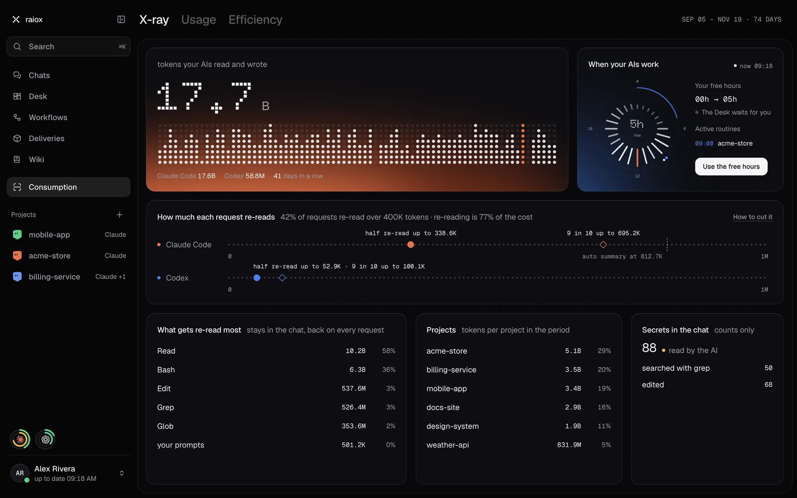

# raiox

**See where your AI coding agents' tokens go, cut the waste, and put the same
agents to work inside each of your projects.** Local only, open source.

On the author's machine, 82,000 Claude Code requests spent **77% of their
cost re-reading old context**; raiox's top suggestion there (compact at 300K
tokens) is estimated to cut that re-reading by **59%**. raiox measures this from
your own logs and applies a cut with a backup and an undo.

It works with the CLIs you already use: **Claude Code, Codex, Cursor, Google's
Antigravity CLI and opencode** (which reaches any provider, free models
included). The token x-ray reads Claude Code and Codex logs; all five can be
the bots in your projects.

## Quick start

1. Download the installer for your system from
   [Releases](https://github.com/Leooleo1/ai-ray-x/releases): macOS (Apple
   Silicon) or Windows (x64). The builds are not signed yet, so the first
   time macOS asks you to right-click › Open and Windows to click More info ›
   Run anyway.
2. Have at least one of the CLIs above installed and signed in.
3. Open raiox. The first run connects your AIs, finds your projects and makes
   a bot for the ones you pick. raiox uploads nothing.

Intel Macs and Linux: [build from source](docs/building.md).

Screenshots show a demo with made-up projects and usage.

## What you get

- **X-ray**: tokens read and written, what they would cost paying per use, how
  much each request re-reads, what gets re-read most, per project.
- **Efficiency**: cuts ranked by the saving, applied with a backup and an undo,
  and measured afterwards.
- **Chats with each project's AI**: it reads while talking; changes it
  proposes are made in a copy you review, apply and undo.
- **Desk and task board**: what every AI is doing, what waits for you, and
  tasks for them.
- **A team**: channels with a free router, a wiki every AI reads, routines,
  and Ray, Diet and Memo, three built-in helpers that answer from your logs
  at no cost.
- **Self-improving agent**: a built-in project template under Add a project
  that interviews you for a niche, tracks real experiments (including free X
  Analytics CSV exports) and evolves versioned playbooks through a statistical
  gate.
- **Anywhere**: your phone (pairing by QR) or Telegram.

Every feature, in detail: [docs/features.md](docs/features.md).

## On by default: Runs without asking

Like a coding CLI in auto mode, each AI runs on its own the commands that only
read, test, lint, build or install the project's locked dependencies, and starts
the project's app (installing its dependencies when they are missing) with a
screenshot. Anything else it asks for (deleting, moving, `git push`, adding a
package, other scripts) still waits for your click. Turn it off per AI in its
settings.

## Off by default: what acts on its own

raiox never changes a project, spends your plan or opens to the internet unless
you ask it to or turn it on. These switches do, so read them before you flip them:

| Switch | What it does | The risk |
|---|---|---|
| **Edits without asking** (per AI) | Approves that AI's proposals and applies the change to the project | Changes land without you reading them first; each one can still be undone |
| **Uses your MCP servers** (per AI, Claude Code) | Lets it use your own MCP servers, with no approval step | It can act in your mail, calendar, drive or anything else those servers reach |
| **Bots pick tasks up** (Desk) | Idle AIs start their next task by themselves | It spends your plan while you are away; set a daily or weekly token ceiling |
| **Reads the web** (per AI) | Lets it open pages and search | What it reads can try to steer it |
| **Phone access** (Settings › Phone) | Opens the panel to a public address through Cloudflare Tunnel | The temporary link is on the internet; only devices you pair get in, and Remove cuts one off at once |
| **Telegram** (Settings › Phone) | Lets one paired Telegram chat talk to your AIs | Anyone holding that phone can use them; proposals still wait in raiox |

## Privacy

- Local only: the panel listens on `127.0.0.1` with a per-run session token.
  With phone access on, a Cloudflare tunnel reaches it, for paired devices only
  (see [From your phone](docs/features.md#from-your-phone)).
- raiox reads your CLIs' logs and keeps an index in your cache folder; it does
  not upload them.
- Secrets are counted, never stored.
- Secrets files (`.env` and its variants, `.dev.vars`, keys, certificates)
  never enter the copies the AIs edit. Claude Code is also denied reading
  them while talking; Codex, Cursor, Antigravity and opencode have no such
  switch, so they are only told not to. Antigravity talks in its plan mode and
  opencode as its plan agent (no edits, no shell); their edits run in the
  draft copy, still without a shell.
- Commands that would open secrets files are refused before you are asked,
  variables that look like secrets stay out of their environment, and values
  that look like secrets are hidden in their output.
- Chats run your own CLI, which talks to its own provider under your account.
- The desktop app checks the latest GitHub release for a new version (a request
  with nothing about you), and installs it only when you press Update, after
  checking its signature.

## Status

Early (0.1). Developed on macOS; tested on Windows 11 (in a VM, ARM64 and
x64); Linux should work.

## License

MIT, see `LICENSE`. Third-party pieces are listed in `THIRD_PARTY_NOTICES.md`.
