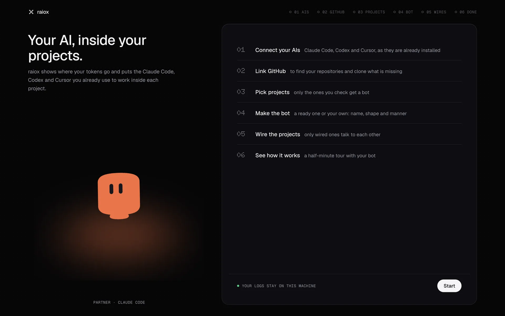
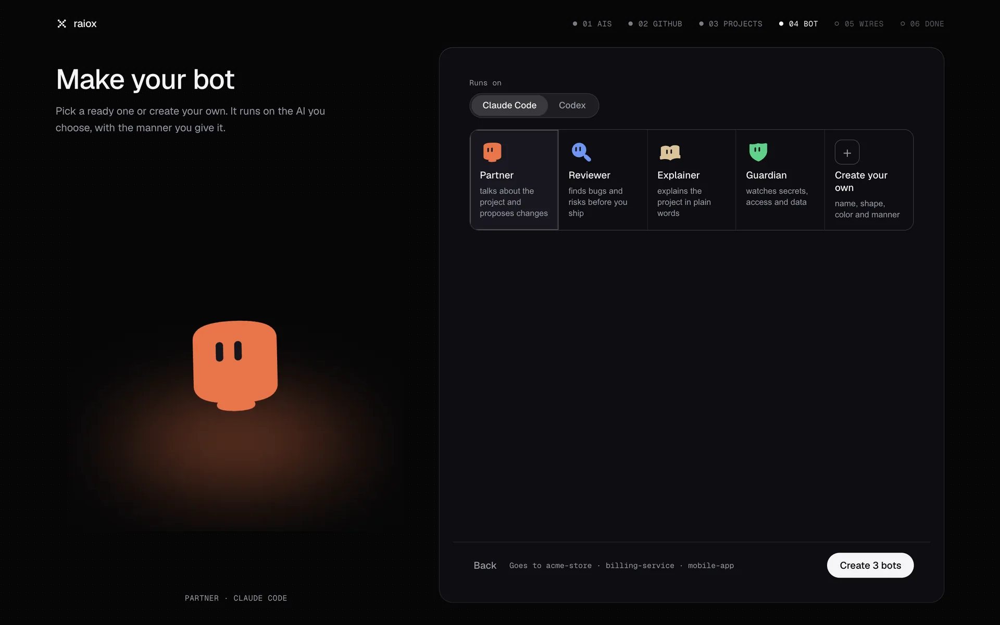
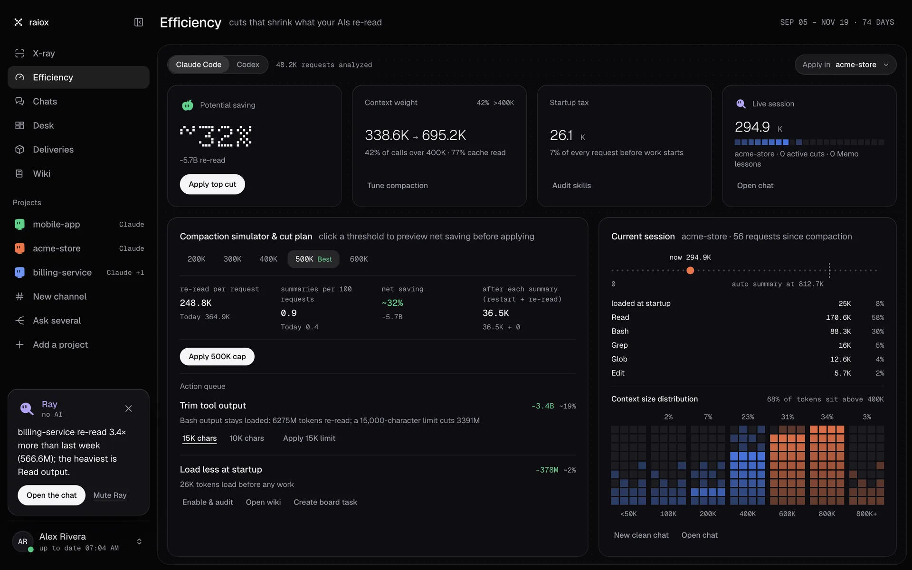
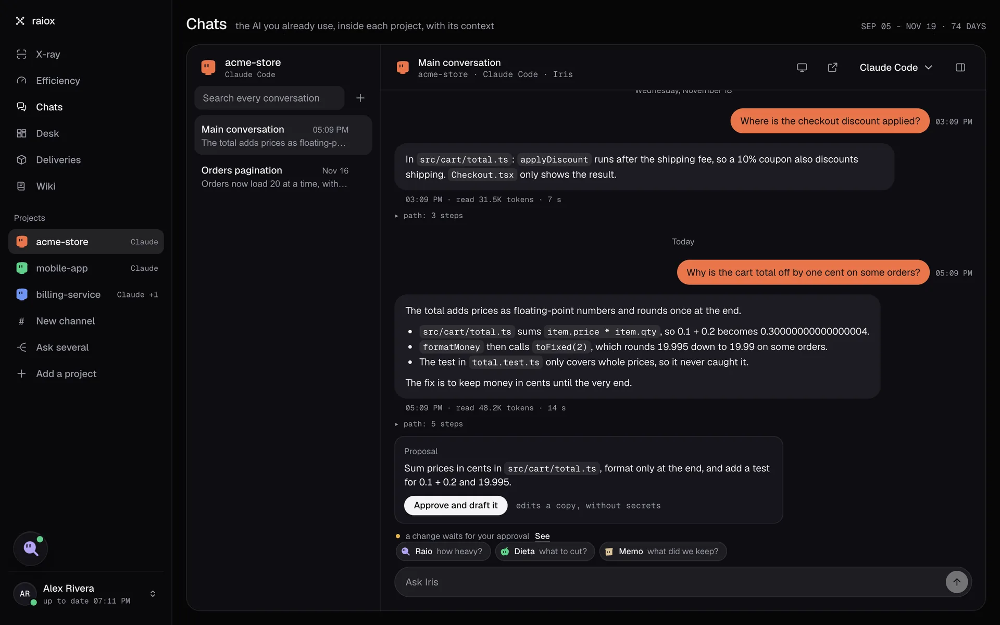
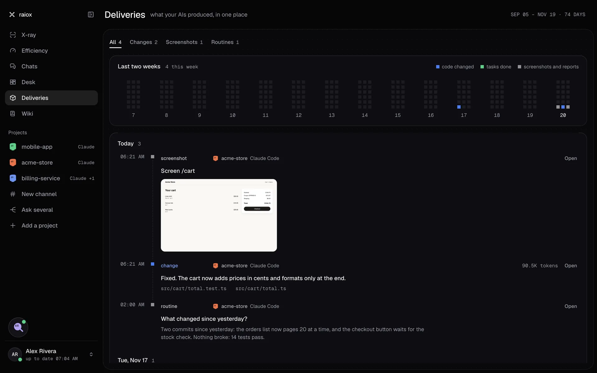
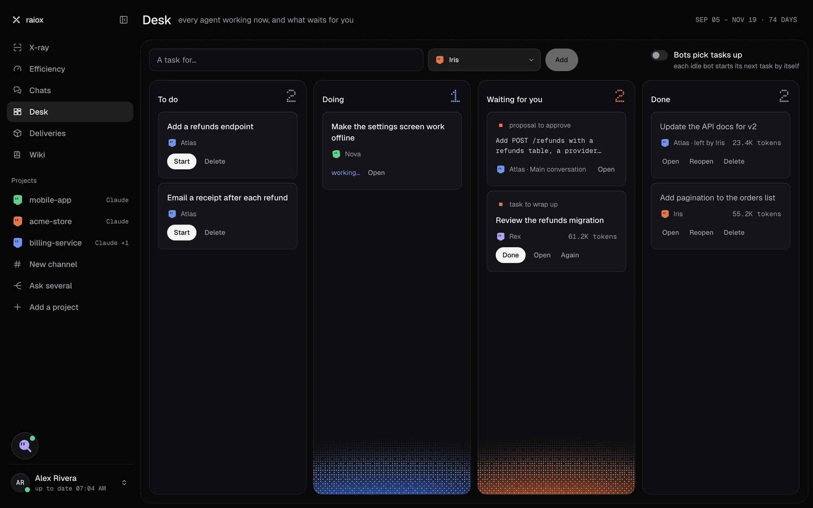
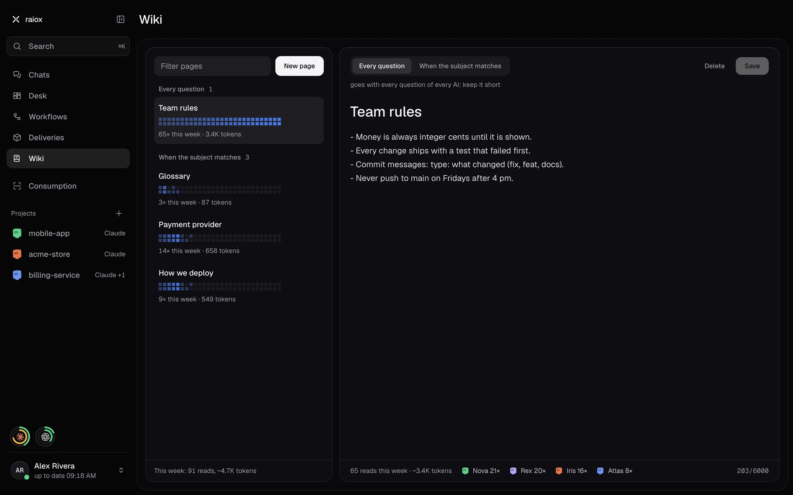

# raiox, feature by feature

The [README](../README.md) is the short version. This is everything raiox does,
with how it does it.

## Contents

- [First run](#first-run)
- [The panel](#the-panel)
- [From your phone](#from-your-phone)
- [Command line and MCP](#command-line)

## First run

The first run connects your AIs (the ones installed and signed in), GitHub
(optional, through `gh`), finds your projects from your logs and your
checkouts, and makes a bot for each project you pick: a ready one or your own
(name, shape, color and manner), on the CLI you choose.




## The panel

**X-ray.** Tokens your AIs read and wrote, what that would cost paying per use,
how much each request re-reads, what gets re-read most (tool output, your own
prompts, system text), tokens per project, and how often a secrets file such as
`.env` entered a conversation (counts only; the text is never kept).

**Efficiency.** Ranked cuts with the estimated saving, measured from your own
logs: compacting earlier, loading less at startup, keeping screenshots out of
the main session. In a project's chat, Diet (one of the three house agents, below) computes them from that
project's own requests once it has enough. The ones that are a setting apply
to the project you pick,
with a backup and an undo, and raiox measures the result afterwards.



**Chats.** Turn on a project and talk to the CLI you already use there (Claude
Code, Codex, Cursor, Google's Antigravity CLI `agy`, or opencode, which reaches
any provider and has free models), with the project's context:

- it only reads while talking. When you approve a proposal, it edits a copy
  of the project (following your `.gitignore`, without secrets files) and you
  see what changed in each file, then apply it to the project (with undo) or
  discard it;
- with two AIs in a project, one can review the other's proposal before you
  approve it (on a click, or every time), and the edit is told what the
  review said;
- when an answer needs a command's output (the git history, the tests), the AI
  asks for it and raiox runs that exact command in the project folder, without
  a shell, after you approve it, or on its own once you allow it for the
  project;
- while the AI works you see its whole path live: each step with what came
  back (lines read, files found, a command's last lines), what it says
  between steps, and the answer as it is written; typing while it works
  corrects its course in the same session, and every answer keeps its path;
- parallel conversations, pinned answers, routines on a schedule (which can
  skip days when nothing in the project changed, and float their answer as a
  tip), one
  question to several projects at once with the answers side by side;
- model and effort per project, optionally a lighter model just for talk
  (changes keep the main one), and a daily token limit per project for its
  bots.

Each message runs the real CLI with your own login, so it counts against your
plan. With Claude Code, a conversation keeps its CLI process open between
messages (closed after ten idle minutes), so a follow-up skips the CLI's start:
about 0.9 s instead of 1.7 s for a short answer, with the same tokens.



**Desk.** One board in four lanes: to do, doing, waiting for you, done.
Doing holds every AI working now, live: what it does, for how long, the tokens
so far (Claude Code), its last steps, and Open, Correct and Stop. Waiting for
you gathers, across all projects, the proposals to approve, drafts to apply,
commands asked, changes asked from a chat and finished tasks to wrap up. A lane
lights up at its foot when something is in it (ember when it waits for you,
cobalt while an AI works). Under the board, the team: each AI with the role
you gave it (it knows its role), its project, CLI, model and what it used
through raiox this week.

**Telegram.** Talk to your AIs from Telegram, through a bot of your own: make
one with @BotFather (`/newbot`), paste its token in Settings › Phone, then open
the bot and press Start (or send it the code shown). raiox asks Telegram for
new messages, so nothing reaches your computer from outside. Only that one chat
is heard, and only the AIs reachable from the phone answer: `/bots` lists
them, `/bot 2` picks who answers. Proposals and drafts still wait in raiox for
your approval. The token stays in a private file next to the index and never
goes on a command line.

**Deliveries.** One page with what your AIs produced. On top, the last two
weeks as a dot-matrix: one pixel per delivery, cobalt for code changed, green
for a task done, grey for screenshots and reports; a day filters the list on a
click. Below, each day on a rail: the changes they made to a project (approved
ones, and what an AI with full access edited, with the files), drafts you
applied (struck through when undone), screenshots, routine results and finished
tasks. Each opens the conversation it came from.



**Board.** The Desk's lanes are also a board of tasks for the AIs. Add one and pick the AI, or let an AI leave
up to three follow-ups at the end of an answer (a `RAIOX-TASK:` line). A task
runs in that AI's "Tasks" conversation, from a fresh session; when the turn
ends it is done, or waiting for you when the AI proposes a change, runs a
command or writes a draft. Each card shows what its task cost in tokens. With
"Bots pick tasks up" on, each idle AI starts its next task by itself, on the
routines' clock.



**Permissions per AI.** In each AI's settings: whether it is reachable from
your paired phone (off keeps it, and the channels it is in, on the computer,
with its notifications), whether it reads the web (Claude Code, opencode),
whether it uses your own MCP servers (Claude Code; it then acts in them
without asking, so only for an AI you trust with them), and a weekly token
ceiling of its own, next to the project's daily one. "Edits without asking"
approves the AI's own proposals and applies the draft to the project by
itself; each change can still be undone from the conversation. "Runs without
asking" (on unless you turn it off) runs on its own the commands that only read,
test, lint, build or install the locked dependencies and, when the AI offers See
the app, installs missing dependencies, starts the app, waits for its page and
shows you a screenshot; anything else still waits for your click. "Full access"
(off unless you turn it on) goes further: the AI works in the project like its
CLI in auto mode, editing files (setting up its .env too, without repeating the
values), running any command (tests, builds, installs, git commit, pull and
push) and starting the app through See the app, with its CLI's own automatic
review stopping what is risky. It is one of four modes beside the
message field, as in a coding CLI: allow (the default: what is safe runs
alone, changes are proposals), approve for me (it applies its own proposals),
auto (this one) and full (the same with no review by the CLI at all, for a
project you can redo). Shift+Tab steps through them and a click lists them;
when an AI that asks first needs more, its answer carries a card that turns on
auto in one click and lets it go on. It asks you before something
hard to undo beyond the project, such as a force push or a deploy.

**Wiki.** Pages all your AIs read: the team's rules, how to deploy, the names
of things. A page goes with every question, or only when the question shares
its words; raiox hands the pages over itself, so the Wiki tab shows how many
times each page was read this week, by which AI, and roughly what that cost in
tokens. The index splits the pages the same way (every question, or when the
subject matches), each with that cost as a strip of pixels. Any answer can be
kept as a page (its question becomes the title).



**Channels.** Rooms with several of your AIs, from any projects. `@handle`
calls a member (several handles call several; `@all` calls them all). With
no handle, a free router picks who the message is about, from each member's
role (and the words that go with it), name, project and project file names,
without asking any AI; with no clear match, the channel's lead answers. Under
the message it says whom it chose, by which words, and how many tokens not
calling the others spared.
Each member answers in a conversation of its own, is told what was said in
the channel since it last spoke, and can ask another member for help; the
request shows as a card and goes on only when you pass it.
Any conversation can be taken to another AI (as a new conversation) or into a
channel: its last exchanges go along, at no token cost, and the next turn
there reads them.

**See the app.** In a project's chat, See the app runs your dev command (raiox
suggests one from `package.json`; it starts only when you press Run), reads
the address it prints and shows the page inside the panel at desktop or phone
width, with the server's output, Stop and screenshots (headless Chrome, local
pages only, never a secrets file). With an iOS simulator booted, it also takes
screenshots of the simulator.

The AI can look too: while the app runs, each question tells it the address,
and it asks for a screenshot by ending its answer with `RAIOX-SHOT: /path` (or
`simulator`, in an iOS project). raiox takes it (at most two per question),
shows it in the chat and hands it back: Claude Code reads it from a folder that
holds only the current question's screenshots, Codex gets it as an image, and
Cursor gets its path.

**Ray, Diet and Memo.** Three house agents inside every project chat. They
answer from the logs, without AI and at no cost: Ray reports what the session
carries and how the project's week compares with the one before, Diet lists
the cuts with Apply, Memo says what was kept and points to ai-memory pages
with the same title or untouched for months, which you can delete. They can also
float a tip now and then; each one can be muted.

**Self-improving agent.** Under Add a project (on the computer only; requires
Python 3), raiox includes an embedded template that creates a local folder in
`~/Projects/<name>`, activates a bot on the CLI you pick, and starts by asking
which niche you want to optimize. It runs a closed loop of hypotheses, A/B
experiments (simulated or from real CSV exports such as X Analytics), guardrail
checks and statistical promotion into versioned playbooks; inside a folder with
its `.raiox-rsi` marker, the engine's subcommands run without asking for a click.

**Dev/Infra Auditor.** Off by default, turned on per project in its Settings
(on the computer only). Audits that project's scripts, CI workflows, raiox
routines, skills (`SKILL.md`), `CLAUDE.md`/`AGENTS.md` and `package.json`
commands with raiox's own runtime rules and recent refused/failed command
telemetry — optionally using another enabled AI CLI for fresh eyes. Runs on
demand, on change (checks daily and skips at 0 tokens if no script, skill,
instruction or routine changed), or weekly, respecting free hours and token
ceilings. Reports land in a dedicated `Dev/Infra Audit` thread and in
Deliveries; audit proposals never auto-edit and always wait in a draft for your
approval.

**ai-memory.** With [ai-memory](https://github.com/akitaonrails/ai-memory)
installed, raiox keeps a pinned page per project (`raiox/equipe.md`) with who
works there and what each AI did last, and every bot reads its own project's
page and those of the projects linked to it before answering, plus the
project's pages that relate to the question. Any answer can be kept as a
decision of the project (`raiox/decisions/…`) with one click, so later
questions find it. Linked projects (Settings › Links)
can message each other through ai-memory, always with your approval.

## From your phone

Settings › Phone opens the panel to your phone through
[Cloudflare Tunnel](https://developers.cloudflare.com/cloudflare-one/connections/connect-networks/)
(`brew install cloudflared`). The panel keeps listening on `127.0.0.1` only;
`cloudflared` carries requests to it from a public address.

- **Temporary link**: a `trycloudflare.com` address, no account needed. It
  changes each time it starts, so devices pair again then.
- **Your domain, with login**: your own tunnel and hostname behind
  [Cloudflare Access](https://developers.cloudflare.com/cloudflare-one/policies/access/).
  raiox checks the Access login on every request (signature, audience, team
  and expiry), so a hostname left without an Access policy still lets nobody
  in. Set it up once:

  ```sh
  cloudflared tunnel login
  cloudflared tunnel create raiox
  cloudflared tunnel route dns raiox raiox.yourdomain.com
  ```

  Then, in Cloudflare Zero Trust, add a self-hosted Access application for
  `raiox.yourdomain.com` with a policy that allows only you, and copy its
  Application Audience (AUD) tag. In raiox, fill in the tunnel name, the
  address, your team domain (`yourteam.cloudflareaccess.com`) and the AUD.

Either way, only devices you pair get in: Settings › Phone shows a QR code
(and the same code to type, for an app opened from the home screen) that
lasts five minutes and works once. The device trades it for a token of
its own (raiox keeps only its hash), and Remove ends its access at once. A
paired device can read the panel, chat, approve and take screenshots; managing
the phone access, changing the setup or the CLIs, starting a dev server and
always-allowing a command stay on the computer.

On the phone, add raiox to the home screen to open it as an app. Its Settings ›
Phone turns on notifications: a short note when an AI finishes, with what it
needs from you. They use Web Push: raiox signs each request with its own key
and encrypts each note for the device, so the push service (Apple's, Google's,
Mozilla's or Microsoft's) only carries it. On iPhone, notifications need raiox
on the home screen.

## Command line

```text
raiox open      Open the panel (the default)
raiox report    Print the report in the terminal
raiox context   What the current session of a folder carries now
raiox weighs    What weighs most over the indexed period (JSON)
raiox diet      Diet's ranked suggestions (JSON); never applies anything
raiox apply     Apply a suggestion to this project (backup and ledger)
raiox undo      Undo an applied change by its id
raiox ask       Ask Ray, Diet or Memo about this project
raiox mcp       MCP server over stdio (reads; proposes team changes)
```

**Set up your team from a chat.** Add the MCP server to the AI you talk to
(for Claude Code: `claude mcp add raiox -- raiox mcp`) and ask, in plain words,
for a bot in a project, a routine, a task, a channel or a message to a
channel. It reads the team with `raiox_team` and calls `propose_change`;
nothing is applied then. Each request waits under "Asked from a chat" on the
Desk until you approve it there (on the computer, never from the phone) or
discard it.

`skills/token-diet` teaches an agent when to call these, and [`agents.md`](agents.md)
describes the three house agents.
